# Datasets

[README](README.md) · [Training](TRAINING.md) · **Datasets** · [Output format (SPEC)](src/diagram_ir/SPEC.md)

This page covers everything the Diagram IR model learned from and was tested on: where each dataset comes from, its license, how it was converted and cleaned into training targets, and how much of it each training stage used.

## At a glance

There are 15 sources with **142,217 image–target pairs** in total.

- **Training (12 sources, 137,189 pairs).** Every license here allows training a model that is released publicly.
- **Test only (3 sources, 5,028 pairs).** These are kept out of training because their licenses do not allow it.

| Dataset | Diagram types | Look | Pairs | Train / val / test | Use | License |
|---|---|---|---:|---|---|---|
| [FlowGen](#flowgen) | flowchart, graph | rendered by Mermaid, Graphviz, PlantUML and `diagrams`; scanned test copies | 20,160 | 10,934 / 586 / 8,640 | train | Apache-2.0 |
| [Image-to-Mermaid v3](#image-to-mermaid-v3) | flowchart, sequence, class, state, ER, graph | Mermaid renders | 9,479 | 7,565 / 936 / 978 | train | MIT |
| [Flowchart-to-Mermaid](#flowchart-to-mermaid) | flowchart | Mermaid renders | 2,568 | 2,053 / 256 / 259 | train | MIT |
| [FlowVQA](#flowvqa) | flowchart | Mermaid renders, top-down and bottom-up | 4,538 | 2,506 / 132 / 1,900 | train | MIT |
| [DiDi](#didi) | flowchart | drawn by hand on a tablet | 58,655 | 43,995 / 7,330 / 7,330 | train | CC BY 4.0 |
| [hdBPMN](#hdbpmn) | activity (BPMN) | photos and scans of hand-drawn BPMN, with boxes | 704 | 432 / 144 / 128 | train | CC BY 4.0 |
| [LogicBench-1K](#logicbench-1k) | circuit | hand-drawn logic circuits, 512×512 scans | 1,000 | 700 / 100 / 200 | train | CC BY 4.0 |
| [CAS2UML](#cas2uml) | class, activity | photos and scans of hand-drawn UML | 557 | 493 / 34 / 30 | train | CC BY 4.0 |
| [The Stack v2 PlantUML](#the-stack-v2-plantuml) | class, sequence, activity, state, graph | real PlantUML code from GitHub, rendered by us | 13,528 | 12,827 / 431 / 270 | train | permissive, per file |
| [Synthetic circuits](#synthetic-logic-circuits) | circuit | generated; clean, scanned and sketched, with boxes | 8,000 | 7,502 / 242 / 256 | train | ours |
| [Synthetic BPMN](#synthetic-bpmn) | activity (BPMN) | generated; tool style and photographed sketches, with boxes | 8,000 | 7,535 / 213 / 252 | train | ours |
| [Synthetic PlantUML](#synthetic-plantuml) | class, sequence, activity, state, graph | generated code, many themes, some handwritten fonts | 10,000 | 9,381 / 322 / 297 | train | ours |
| [Handwritten diagrams](#handwritten-diagram-datasets-test-only) | flowchart, state | scans of hand-drawn diagrams, with boxes | 1,391 | test only | eval only | CC BY-NC-SA 3.0 / none |
| [rakitha flowcharts](#rakitha-flowcharts-test-only) | flowchart | Mermaid renders plus augmented copies | 688 | test only | eval only | none stated |
| [UML-in-the-Wild](#uml-in-the-wild-test-only) | class, sequence, activity, state, graph | GitHub PlantUML, rendered by us | 2,949 | test only | eval only | per file, not recorded |

The diagram types are the ones defined in the [output format](src/diagram_ir/SPEC.md#2-vocabularies). `graph` covers generic node-link diagrams such as mind maps, architecture, component and use-case diagrams.

## How the data is built

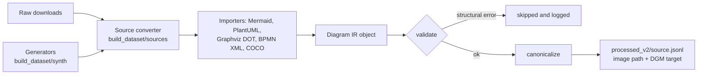

**1. Download.** Everything is stored under `D:/data/diagram_extraction`. There are two downloaders:

```powershell
cd src
# Hugging Face repos with few files (cas2uml, flowchart_to_mermaid, plantuml_stack_v2, rakitha)
python download_dataset/download.py --stage v2_diagram --download
python download_dataset/download.py --dataset mermaid_flowchart_transformer --download
# Git, Zenodo and plain-URL sources (FlowGen, Image-to-Mermaid, LogicBench, FlowVQA, hdBPMN, DiDi, ...)
python download_dataset/download_sources.py --download
```

The manifests are [`datasets.yaml`](src/download_dataset/datasets.yaml) and [`sources_v2.yaml`](src/download_dataset/sources_v2.yaml).

- **Gated repos** need `HF_TOKEN` in a `.env` file.
- **Repos with tens of thousands of files** use `git clone` and batched `git lfs pull`. This avoids Hugging Face's API limit of 5,000 requests per 5 minutes.
- **Finished datasets** are recorded in `sources-lock.json` and skipped on re-runs.

**2. Convert.** Each source has a converter in [`src/build_dataset/sources/`](src/build_dataset/sources). It reads the source's own structured ground truth (render code, XML, annotations) and turns it into one canonical DGM target per image.

```powershell
cd src
python -m build_dataset --list                    # sources and their status
python -m build_dataset --source hdbpmn           # one source
python -m build_dataset --source flowgen --limit 200   # quick check
python -m build_dataset --all
```

**3. Output.** Each source produces a file `processed_v2/<source>.jsonl` with one row per image. Image paths are relative to the data root. Images that had to be extracted or rendered go to `processed_v2/images/<source>/`. Here is a real row:

```json
{
  "id": "flowchart_to_mermaid/easy_0156",
  "source": "flowchart_to_mermaid",
  "split": "test",
  "image": "processed_v2/images/flowchart_to_mermaid/test/easy_0156.png",
  "type": "flowchart",
  "dgm": "diagram flowchart dir=TB\nnode n1 process \"Start\"\nnode n2 process \"Enter Details\"\nnode n3 decision \"Valid Details?\"\n...",
  "has_layout": false,
  "use": "train",
  "license": "MIT",
  "meta": {"level": "easy"}
}
```

### Cleaning rules that apply to every source

- **Ground truth comes from structure, never from OCR or another model.** Every target is derived from the source's own code (Mermaid, PlantUML, DOT), model files (BPMN XML, XMI) or human annotations (COCO, gate graphs).
- **Every target is validated** against the [data model](src/diagram_ir/SPEC.md#6-validation). Samples fail on an unknown diagram type, a malformed or duplicate id, a malformed kind, or an edge that points to a missing element. Failures are skipped with the reason logged. A kind outside the type's vocabulary is only a warning.
- **Every target is canonical.** Each diagram has exactly one target text: stable ids (`n1…`, `g1…`), nodes in "follow the arrows" order, and undirected edges written from the earlier endpoint. Canonicalizing a target a second time leaves it unchanged, except for about 0.1% of real-world PlantUML diagrams. The model never has to guess between equivalent orderings.
- **Duplicates are removed.** Code-only corpora are deduplicated by a hash of the normalized source text.
- **License decides use.** `use: train` only when the license allows training a public model. Otherwise the source is `eval_only` with split `test`.
- **Rendered sources use only what is drawn.** Only the first `@startuml` block is rendered and imported. Renders that PlantUML marks as errors, or that hit its size limit and get cropped, are dropped.
- **Boxes are kept where the source has real geometry.** That means hdBPMN, the handwritten sets and the synthetic circuits and BPMN. Boxes use 0–1000 coordinates on the saved image. Sources whose images were drawn by someone else's renderer carry no boxes, because a fresh layout would not match their pixels.
- **Size limits.** Training skips targets over 4,500 characters (about 1,500 tokens); RL skips those over 3,000. Images are resized to between 256×256 and about 1120×1120 pixels, which is 64 to 1,225 visual tokens. Transparent PNGs are flattened onto white so black lines stay visible.
- **Splits.**
  - Native splits are kept where they exist.
  - CAS2UML, FlowVQA and FlowGen move 5% of their train split to val.
  - hdBPMN is split by writer, as in its papers.
  - Synthetic sets are split by a hash of the sample id: 3% test, 3% val.

---

## Training sources

### FlowGen

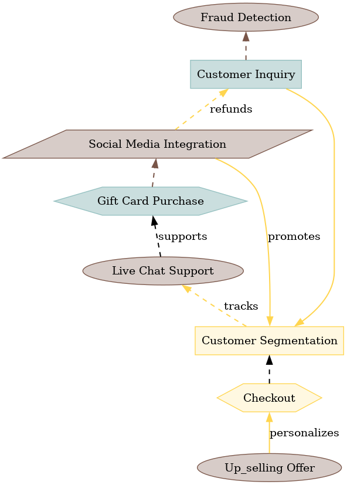

- **Source:** [Anonymous112233/FlowGen](https://huggingface.co/datasets/Anonymous112233/FlowGen) (ICLR 2026)
- **License:** Apache-2.0
- **Size:** 20,160 pairs (10,934 train / 586 val / 8,640 test)
- **Types:** flowchart (15,120), graph (5,040)

FlowGen renders the same kind of diagram with four renderers (Mermaid, Graphviz, PlantUML and the Python `diagrams` package) at three difficulty levels. Its test split also has scanned-looking copies. Each sample comes with its render code and gold triplets `<source, relation, target>`.

How it was converted and cleaned:

- **Matching:** the render code is parsed into the IR, and junction dots are folded into direct edges. A sample is kept only if its edges match the gold triplets exactly. All 20,160 passed.
- **Upstream bugs handled:**
  - Unquoted cluster names that Graphviz rejects get quoted.
  - The triplets name the wrong container (`X partOf X`); for those, only the members are compared.
  - Scanned files follow the `*_scanned.png` naming.
- **Shapes:** the `diagrams` renderer draws different shapes than its DOT names say; a box is drawn as a diamond, for example. A decoded shape map, checked by eye, fixes the node kinds.
- **No boxes:** FlowGen drew its own images.

<br clear="right">

<details><summary>Target for the example above (test split)</summary>

```text
diagram flowchart dir=BT
node n1 terminal "Up_selling Offer"
node n2 preparation "Checkout"
node n3 process "Customer Segmentation"
node n4 terminal "Live Chat Support"
node n5 preparation "Gift Card Purchase"
node n6 io "Social Media Integration"
node n7 process "Customer Inquiry"
node n8 terminal "Fraud Detection"
edge n1 n2 "personalizes"
edge n2 n3 style=dashed
edge n3 n4 "tracks" style=dashed
edge n4 n5 "supports" style=dashed
edge n5 n6 style=dashed
edge n6 n3 "promotes"
edge n6 n7 "refunds" style=dashed
edge n7 n3
edge n7 n8 style=dashed
```

</details>

### Image-to-Mermaid v3

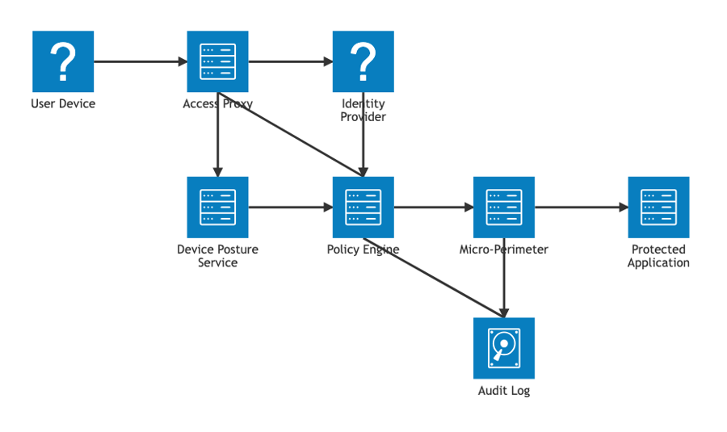

- **Source:** [DangIT02/image-to-mermaid-v3](https://huggingface.co/datasets/DangIT02/image-to-mermaid-v3)
- **License:** MIT
- **Size:** 9,479 pairs (7,565 train / 936 val / 978 test)
- **Types:** flowchart 3,007, sequence 2,001, graph 1,581, class 1,437, ER 736, state 717

The dataset has 15,099 images over 26 Mermaid diagram types at three difficulty tiers.

- **Conversion:** a Mermaid importer covers flowchart, sequence, class, state, ER, mind map, C4 and architecture diagrams, at 99.8%+ parse rates.
- **Skipped:** types that are charts or timelines (pie, gantt, xychart, sankey, journey, gitGraph, …) have no graph structure.
- **Splits:** native.

<br clear="right">

<details><summary>Target for the example above (architecture diagram, test split)</summary>

```text
diagram graph
node n1 other "User Device"
node n2 box3d "Access Proxy"
node n3 other "Identity Provider"
node n4 box3d "Policy Engine"
node n5 box3d "Device Posture Service"
node n6 box3d "Micro-Perimeter"
node n7 storage "Audit Log"
node n8 box3d "Protected Application"
edge n1 n2
edge n2 n3
edge n2 n4
edge n2 n5
edge n3 n4
edge n4 n6
edge n4 n7
edge n5 n4
edge n6 n7
edge n6 n8
```

</details>

### Flowchart-to-Mermaid

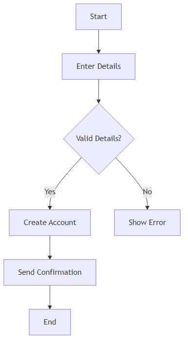

- **Source:** [DangIT02/flowchart-to-mermaid](https://huggingface.co/datasets/DangIT02/flowchart-to-mermaid)
- **License:** MIT
- **Size:** 2,568 pairs (2,053 train / 256 val / 259 test)

This is the earlier, flowchart-only release from the Image-to-Mermaid authors. Each Parquet row holds the image and a conversation whose answer is the Mermaid code. Images are extracted once, the Mermaid is converted to DGM, and the native splits are kept.

<br clear="right">

<details><summary>Target for the example above (test split)</summary>

```text
diagram flowchart dir=TB
node n1 process "Start"
node n2 process "Enter Details"
node n3 decision "Valid Details?"
node n4 process "Create Account"
node n5 process "Show Error"
node n6 process "Send Confirmation"
node n7 process "End"
edge n1 n2
edge n2 n3
edge n3 n4 "Yes"
edge n3 n5 "No"
edge n4 n6
edge n6 n7
```

</details>

### FlowVQA

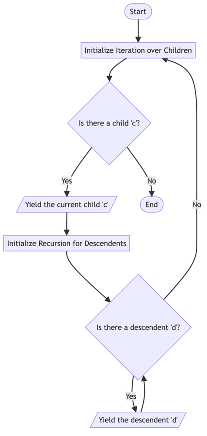

- **Source:** [flowvqa/flowvqa](https://github.com/flowvqa/flowvqa)
- **License:** MIT
- **Size:** 4,538 pairs (2,506 train / 132 val / 1,900 test)

FlowVQA has 2,272 flowcharts built from wikiHow articles, Instructables guides and code snippets, each with Mermaid code.

- **Two samples per chart:** every chart is also rendered bottom-to-top, and that copy becomes a second sample with `dir=BT`.
- **Skipped:** about 260 images that have no record in the JSON files.
- **Val split:** 5% of the train keys, with both renderings of a chart kept in the same split.

<br clear="right">

<details><summary>Target for the example above (test split)</summary>

```text
diagram flowchart dir=TB
node n1 terminal "Start"
node n2 process "Initialize Iteration over Children"
node n3 decision "Is there a child 'c'?"
node n4 io "Yield the current child 'c'"
node n5 terminal "End"
node n6 process "Initialize Recursion for Descendents"
node n7 decision "Is there a descendent 'd'?"
node n8 io "Yield the descendent 'd'"
edge n1 n2
edge n2 n3
edge n3 n4 "Yes"
edge n3 n5 "No"
edge n4 n6
edge n6 n7
edge n7 n2 "No"
edge n7 n8 "Yes"
edge n8 n7
```

</details>

### DiDi

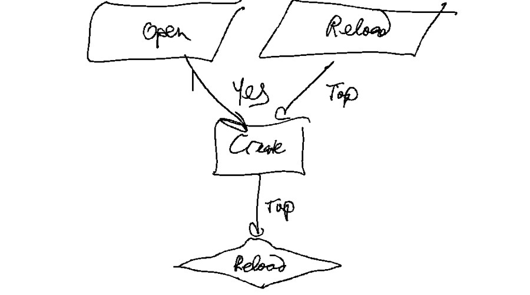

- **Source:** [DiDi: Digital Ink Diagram data](https://github.com/google-research/google-research/tree/master/didi_dataset), Gervais et al. 2020 ([arXiv:2002.09303](https://arxiv.org/abs/2002.09303))
- **License:** CC BY 4.0
- **Size:** 58,655 pairs (43,995 train / 7,330 val / 7,330 test)

People redrew 6,555 Graphviz prompts by hand on a tablet. 22,287 drawings include the prompt's text and 36,368 are shape-only.

- **Images:** the pen strokes are rasterized as black ink on white, 1,024 px on the longest side.
- **Targets:** each comes from the prompt's `.dot` file. The prompt shapes oval, box, diamond and parallelogram map to flowchart kinds. Octagon becomes `other`, since it is not a flowchart symbol.
- **No boxes:** writers follow the prompt only loosely.
- **Splits:** native.
- **Use in training:** this is by far the largest source, so training capped it at 12,000 per epoch.

<br clear="right">

<details><summary>Target for the example above (test split)</summary>

```text
diagram flowchart dir=TB
node n1 io "Open"
node n2 io "Reload"
node n3 process "Create"
node n4 decision "Reload"
edge n1 n3 "Yes"
edge n2 n3 "Top"
edge n3 n4 "Top"
```

</details>

### hdBPMN

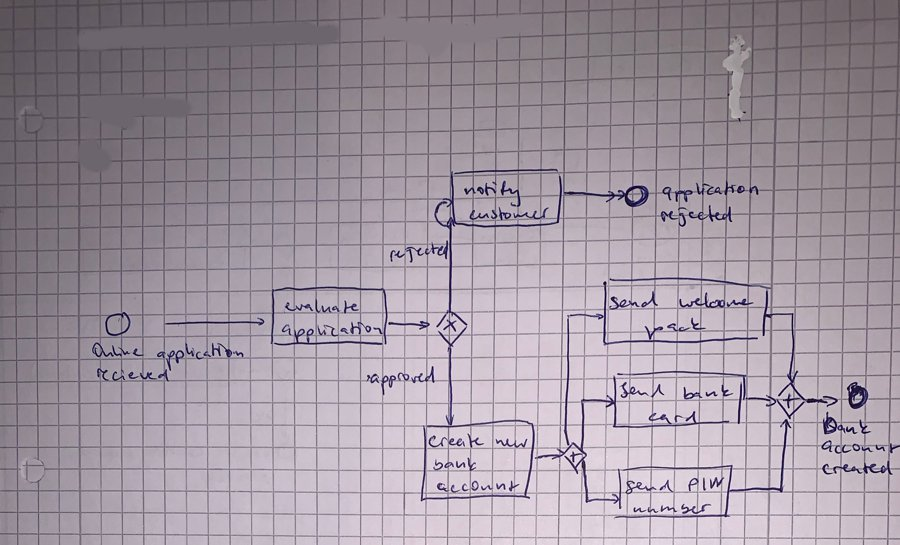

- **Source:** [dwslab/hdBPMN](https://github.com/dwslab/hdBPMN)
- **License:** CC BY 4.0
- **Size:** 704 pairs (432 train / 144 val / 128 test), all with boxes

hdBPMN has photos and scans of hand-drawn BPMN process models. Each one comes with a BPMN XML file that gives the shape bounds and the waypoints of every arrow. The XML bounds are scaled to the photo, so they convert directly to the 0–1000 grid. BPMN maps to the `activity` vocabulary:

| BPMN | DGM |
|---|---|
| task, sub-process, call activity | `action` |
| start / end event | `initial` / `final` |
| message / timer / other intermediate event | `receive_signal`, `send_signal` / `time_event` / `other` |
| exclusive, inclusive, event-based gateway | `decision` (fan-out) or `merge` (fan-in) |
| parallel gateway | `fork` (fan-out) or `join` (fan-in) |
| data object / data store | `object` (stores get `stereo=datastore`) |
| text annotation | `note` |
| sequence / message / data flow | `flow` / `flow style=dashed` / `flow style=dotted` |
| pool, lane | `lane` groups, lanes nested in their pool |

Message flows to a collapsed pool point at the pool group. Splits follow the papers' split by writer (`data/writer_split.csv`), so no writer's handwriting appears in more than one split. hdBPMN is small but the hardest real source, so training oversamples it ×4.

<br clear="right">

<details><summary>Target for the example above (test split; boxes are x1,y1,x2,y2 on a 0–1000 grid)</summary>

```text
diagram activity
node n1 initial "Online application\nrecieved" @118,573,144,617
node n2 action "evaluate\napplication" @300,528,430,624
node n3 decision @483,568,518,636
node n4 action "notify\ncustomer" @500,314,620,413
node n5 action "create new\nbank\naccount" @470,776,590,908
node n6 final "application\nrejected" @694,338,720,380
node n7 fork @623,812,650,862
node n8 action "send welcome\npack" @670,510,850,624
node n9 action "Send bank\ncard" @680,693,820,776
node n10 action "send PIN\nnumber" @680,858,810,941
node n11 join @865,702,896,763
node n12 final "bank\naccount\ncreated" @940,710,965,743
edge n1 n2
edge n2 n3
edge n3 n4 "rejected"
edge n3 n5 "approved"
edge n4 n6
edge n5 n7
edge n7 n8
edge n7 n9
edge n7 n10
edge n8 n11
edge n9 n11
edge n10 n11
edge n11 n12
```

The spelling "recieved" is in the original annotation and is kept as written.
</details>

### LogicBench-1K

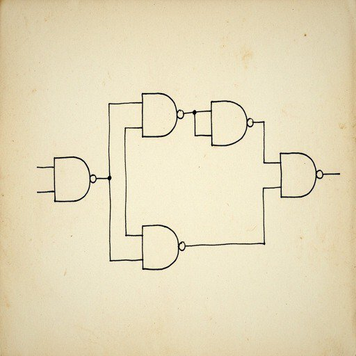

- **Source:** [TKCL-HF/LogicBench-1K](https://huggingface.co/datasets/TKCL-HF/LogicBench-1K)
- **License:** CC BY 4.0
- **Size:** 1,000 pairs (700 train / 100 val / 200 test)

This set has 512×512 scans of hand-drawn digital logic circuits in varying orientations. Each is annotated as a gate-level directed graph.

- **Targets:** primary inputs and outputs are drawn as bare wires and are not annotated, so targets list gates and wires only.
- **Edge direction:** this is not documented upstream. Read as driver → receiver, 87 of 1,389 NOT gates have more than one input; read the other way, 269 would have more than one output. So edges are kept as given, which matches the IR's `wire` convention.
- **Label noise:** about 6% of gates exceed their type's fan-in, so the labels are slightly noisy.
- **No boxes:** the source has no geometry.
- **Use in training:** oversampled ×3.

<br clear="right">

<details><summary>Target for the example above (test split)</summary>

```text
diagram circuit
node n1 nand
node n2 nand
node n3 nand
node n4 nand
node n5 nand
edge n1 n2
edge n1 n3
edge n2 n4
edge n3 n5
edge n4 n5
```

</details>

### CAS2UML

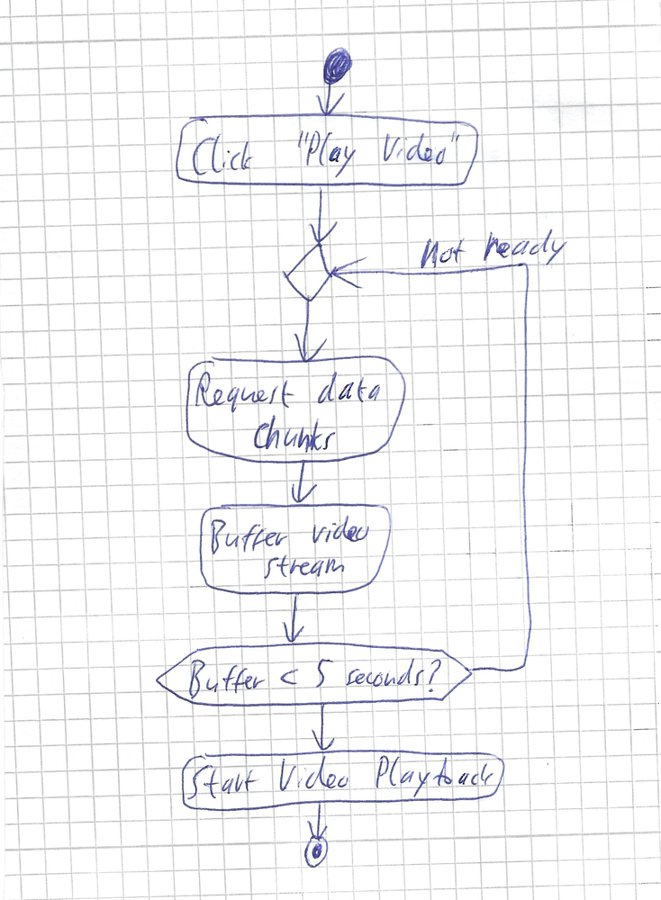

- **Source:** [Seym0n/cas2uml_hand-drawn_to_plantuml_dataset](https://huggingface.co/datasets/Seym0n/cas2uml_hand-drawn_to_plantuml_dataset)
- **License:** CC BY 4.0
- **Size:** 557 pairs (493 train / 34 val / 30 test): 271 class diagrams, 286 activity diagrams

Photos and scans of hand-drawn UML, each with PlantUML and XMI ground truth.

- **Conversion:** our PlantUML importer reproduces the XMI exactly on all 271 class diagrams (classes, relations, direction, multiplicities). That makes PlantUML a trustworthy target for the activity diagrams too.
- **Splits:** native train and test kept; 5% of train became val.
- **Use in training:** oversampled ×3 in stage 2 and ×2 in stage 3.

<br clear="right">

<details><summary>Target for the example above (val split)</summary>

```text
diagram activity dir=TB
node n1 initial
node n2 action "Click \"Play Video\""
node n3 merge
node n4 action "Request data chunks"
node n5 action "Buffer video stream"
node n6 decision "Buffer < 5 seconds?"
node n7 action "Start Video Playback"
node n8 final
edge n1 n2
edge n2 n3
edge n3 n4
edge n4 n5
edge n5 n6
edge n6 n3 "not ready"
edge n6 n7
edge n7 n8
```

</details>

### The Stack v2 PlantUML

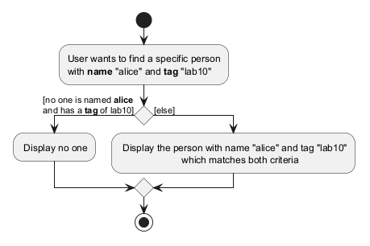

- **Source:** [devgpt-aimotion/the-stack-v2_PlantUML_filtered](https://huggingface.co/datasets/devgpt-aimotion/the-stack-v2_PlantUML_filtered), which holds PlantUML code only and no images
- **License:** only files from permissively licensed repositories (MIT, Apache-2.0, BSD, …); each sample records its license
- **Size:** 13,528 pairs (12,827 train / 431 val / 270 test)
- **Types:** class 5,309, sequence 4,082, graph 1,998, activity 1,584, state 555

This is real-world UML that developers wrote. We render the images ourselves with PlantUML 1.2026.8.

Pipeline (shared with UML-in-the-Wild):

1. **Parse** with our PlantUML importer (class, sequence, activity, state, use case; 97–99% parse rate).
2. **Deduplicate** by normalized content.
3. **Drop** diagrams with fewer than 2 nodes, or with targets over 4,500 characters.
4. **Drop class diagrams with duplicate class names.** This works around a known importer gap: a namespaced class referenced by its short name would appear as a phantom extra class.
5. **Pick** a balanced number per diagram type.
6. **Render** the first `@startuml` block. Error and cropped renders are dropped. The deprecated `skinparam handwritten true` is rewritten to `!option handwritten true`, because the old form now draws a warning banner into the image.

<br clear="right">

<details><summary>Target for the example above (val split; source file MIT-licensed)</summary>

```text
diagram activity dir=TB
node n1 initial
node n2 action "User wants to find a specific person\nwith name \"alice\" and tag \"lab10\""
node n3 decision
node n4 action "Display no one"
node n5 action "Display the person with name \"alice\" and tag \"lab10\"\nwhich matches both criteria"
node n6 merge
node n7 final
edge n1 n2
edge n2 n3
edge n3 n4 "[no one is named alice\nand has a tag of lab10]"
edge n3 n5 "[else]"
edge n4 n6
edge n5 n6
edge n6 n7
```

</details>

---

## Synthetic sources (generated in this project)

The real data was thin in three places: big logic circuits, BPMN, and UML in varied visual styles. These generators produce thousands of diagrams whose targets are exact by construction. All three are deterministic per sample index, so any sample can be regenerated.

### Synthetic logic circuits

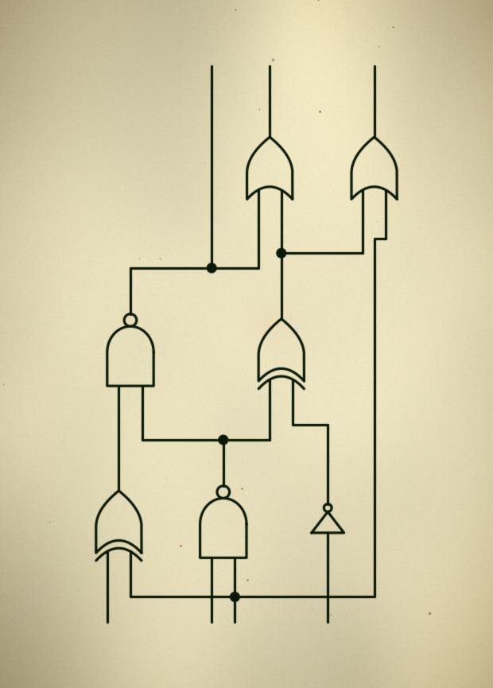

- **Code:** [`sources/synth_circuits.py`](src/build_dataset/sources/synth_circuits.py) with `synth/circuit_*.py`
- **Size:** 8,000 pairs (7,502 train / 242 val / 256 test), all with boxes

The generator builds random combinational circuits: 2–6 inputs, 2–16 gates and 1–3 outputs. About 15% are textbook circuits such as adders, multiplexers and decoders. Gates are laid out in columns by logic depth with orthogonal wires. They are drawn with schemdraw on white, cream-scanned or grid paper, as clean drawings or sketches, in four orientations.

Target conventions:

- **Gates:** `and, or, not, nand, nor, xor, xnor, buf`, with no text.
- **Labeled style (about half):** inputs and outputs are `input` / `output` nodes carrying their label (`A`, `Cin`, `S`, …).
- **Bare style:** inputs and outputs are unlabeled wire stubs, as in LogicBench, so they are not nodes.
- **Wires:** each runs driver → sink, with one edge per sink on fan-out. Junction dots are never nodes.
- **Boxes:** tight around each gate symbol.

<br clear="right">

<details><summary>Target for the example above (bare style, test split)</summary>

```text
diagram circuit dir=BT
node n1 xor @192,711,290,817
node n2 nand @403,704,503,813
node n3 not @629,731,700,776
node n4 nand @215,454,314,563
node n5 xor @522,462,619,567
node n6 or @498,197,596,291
node n7 or @710,197,808,291
edge n1 n4
edge n2 n4
edge n2 n5
edge n3 n5
edge n4 n6
edge n5 n6
edge n5 n7
```

</details>

### Synthetic BPMN

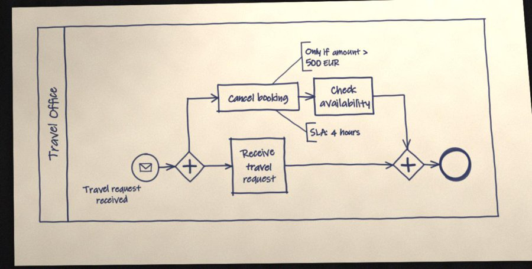

- **Code:** [`sources/synth_bpmn.py`](src/build_dataset/sources/synth_bpmn.py) with `synth/bpmn_*.py`
- **Size:** 8,000 pairs (7,535 train / 213 val / 252 test), all with boxes

The generator builds random block-structured processes.

- **Process content:** sequences; XOR, AND, OR and event-based gateway blocks; loops; early exits; timer and message events.
- **Containers:** one to three lanes, plus partner pools (collapsed or expanded) with message flows, data objects, data stores and text annotations.
- **Two drawing styles:**
  - About 40% clean, in a tool style like bpmn.io or Camunda.
  - About 60% hand-sketched with pen strokes and handwriting fonts on squared, lined or plain paper, then "photographed" with rotation, perspective, uneven light, blur, noise and JPEG artifacts, or scanned.

The target mapping is the same as for [hdBPMN](#hdbpmn), so the two sources teach one convention.

<br clear="right">

<details><summary>Target for the example above (val split)</summary>

```text
diagram activity
node n1 initial "Travel request\nreceived" @249,574,299,673
node n2 fork @329,563,385,675
node n3 action "Cancel booking" @409,310,562,413
node n4 action "Receive\ntravel\nrequest" @435,516,539,719
node n5 note "Only if amount >\n500 EUR" @566,154,706,264
node n6 action "Check\navailability" @590,289,702,427
node n7 note "SLA: 4 hours" @576,456,692,526
node n8 join @738,555,796,670
node n9 final @825,551,886,670
edge n1 n2
edge n2 n3
edge n2 n4
edge n3 n5 anchor
edge n3 n6
edge n3 n7 anchor
edge n4 n8
edge n6 n8
edge n8 n9
group g1 lane "Travel Office" @70,72,937,824 : n1 n2 n3 n4 n5 n6 n7 n8 n9
```

</details>

### Synthetic PlantUML

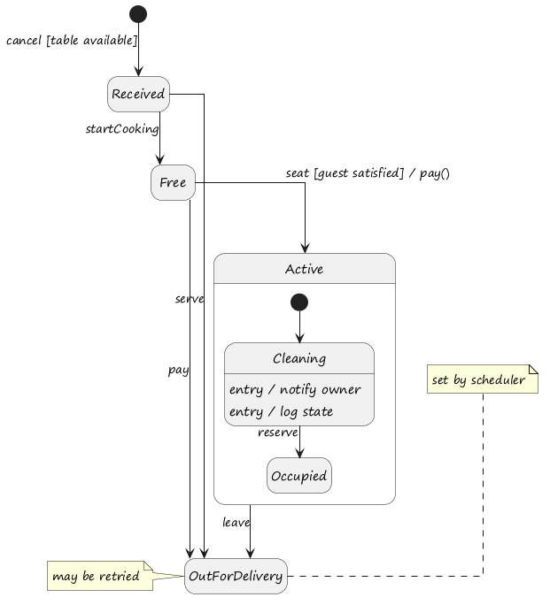

- **Code:** [`sources/synth_plantuml.py`](src/build_dataset/sources/synth_plantuml.py) with `synth/puml_*.py`
- **Size:** 10,000 pairs (9,381 train / 322 val / 297 test)
- **Types:** class 3,000, sequence 2,500, activity 2,000 (about half with swimlanes), graph 1,300 (use case, component), state 1,200

The generators write random but realistic PlantUML with names from 14 business domains. The look varies too: built-in themes, `!option handwritten true`, handwriting and plain fonts, monochrome, orthogonal or polyline lines, left-to-right layouts, colors.

Two checks keep every image and target in agreement:

- **Structure check.** Each generator also builds the diagram it intends to draw. A sample is kept only if our importer reads the generated code back to the same diagram (up to ids and order).
- **Text check.** Every batch is also rendered as SVG. A sample is kept only if every word of the target is actually drawn and nothing else is. This catches renderer quirks: Graphviz dropping an edge label it cannot place, deprecation banners, crash images.

<br clear="right">

<details><summary>Target for the example above (handwritten-font state diagram, test split)</summary>

```text
diagram state dir=TB
node n1 initial
node n2 state "Received"
node n3 state "Free"
node n4 state "OutForDelivery"
node n5 initial
node n6 note "may be retried"
node n7 note "set by scheduler"
node n8 state "Cleaning"
  attr "entry / notify owner"
  attr "entry / log state"
node n9 state "Occupied"
edge n1 n2 "cancel [table available]"
edge n2 n3 "startCooking"
edge n2 n4 "serve"
edge n3 n4 "pay"
edge n3 g1 "seat [guest satisfied] / pay()"
edge n4 n6 anchor
edge n4 n7 anchor
edge n5 n8
edge g1 n4 "leave"
edge n8 n9 "reserve"
group g1 composite "Active" : n5 n8 n9
```

</details>

---

## Test-only sources

These sets are never used for training, because their licenses do not allow training a model that is released publicly. They measure how the model does on styles it has never seen. No example images are reproduced here for the same license reasons; follow the links to see them.

### Handwritten diagram datasets (test only)

- **Source:** [bernhardschaefer/handwritten-diagram-datasets](https://github.com/bernhardschaefer/handwritten-diagram-datasets)
- **License:** FC_A is CC BY-NC-SA 3.0; FA and FC_Bscan have none
- **Size:** 1,391 test pairs (1,091 flowcharts, 300 finite automata as `state`), all with boxes

The annotations are in COCO format: shapes, arrows with explicit start and end shapes, and text boxes.

- **Text:** text inside or linked to a shape becomes the shape's text. Other text becomes the label of the nearest arrow, such as transition labels or yes/no.
- **Automata:** start arrows have no source, so they get an `initial` marker node at the arrow's tail.
- **FC_Bscan:** LaTeX transcriptions (`$M=1$`) are reduced to plain text.
- **FC_B:** skipped. It shows the same diagrams as FC_Bscan without transcriptions.

### rakitha flowcharts (test only)

- **Source:** [rakitha/mermaid-flowchart-transformer](https://huggingface.co/datasets/rakitha/mermaid-flowchart-transformer)
- **License:** none stated on the dataset card
- **Size:** 688 test pairs

These are flowchart images with Mermaid code, including augmented copies (Gaussian noise, rotation, …). Because no license is stated, they are used only as extra flowchart test data.

### UML-in-the-Wild (test only)

- **Source:** [Zenodo record 20537143](https://zenodo.org/records/20537143), 143,427 PlantUML files from open-source repositories
- **License:** the compilation is CC BY 4.0, but each file keeps its source repository's license, which the dataset does not record
- **Size:** 2,949 test pairs (class 897, sequence 698, graph 598, activity 413, state 343)

This set goes through the same pipeline as [The Stack v2 PlantUML](#the-stack-v2-plantuml), on a type-balanced pick of 3,000 diagrams, rendered by us. The 37.7 GiB image archive is not downloaded, because we need our own renders to get exact targets. Training on it would be a licensing decision, not a technical one; it is one setting in [`uml_in_the_wild.py`](src/build_dataset/sources/uml_in_the_wild.py).

---

## How each training stage used the data

Each epoch is a fresh mix.

- **`cap`:** the maximum number of rows taken from a source.
- **`×` (weight):** repeats a source, or subsamples it when below 1.
- **Batches:** grouped by estimated length.

See [TRAINING.md](TRAINING.md#training-stages) for what each stage was for.

| Source | Stage 1 | Stage 2 | Stage 3 | RL prompt weight |
|---|---|---|---|---|
| FlowGen | ×1 | ×1 | cap 2,000 | 2.0 |
| DiDi | cap 12,000 | cap 12,000 | cap 2,000 | 1.5 |
| FlowVQA | ×1.5 | ×1.5 | cap 1,000 | 0.5 |
| Flowchart-to-Mermaid | ×1.5 | ×1.5 | cap 700 | 1.0 |
| Image-to-Mermaid v3 | ×1 | ×1 | cap 2,000 | 1.5 |
| hdBPMN | ×4 | ×4 | ×4 | 3.0 |
| LogicBench-1K | ×3 | ×3 | ×3 | 3.0 |
| CAS2UML | – | ×3 | ×2 | 1.5 |
| The Stack v2 PlantUML | – | cap 12,000 | cap 2,500 | 2.5 |
| Synthetic circuits | – | – | cap 5,000 | 2.5 |
| Synthetic BPMN | – | – | cap 5,000 | 1.5 |
| Synthetic PlantUML | – | – | cap 4,000 | 1.0 |
| **Samples per epoch** | **41,154** | **54,633** | **29,014** | 4 images × 6 answers per step |

- **Weights in the RL column:** these are from the second RL run.
- **RL prompt pool:** RL draws its training images from a pool. A greedy pass scored 120 candidates per source, and the pool keeps mostly the ones the model does not yet get exactly right. In the second run that was 626 of 1,440 (912 were already perfect).

## Datasets downloaded but not used

| Dataset | Why not |
|---|---|
| [CGHD](https://zenodo.org/records/17469897) (hand-drawn electrical circuits, CC BY 4.0) | Has component boxes but no wiring annotations, so no graph targets can be built |
| [Mermaid_50K](https://huggingface.co/datasets/CoreFidelity/Mermaid_50K) | PolyForm Noncommercial license; deprecated upstream |
| Mermaid_500k | Paid license |
| Roboflow diagram sets | Need an API key |
| ChartQA, PlotQA, FigureQA, AI2D, DiagramGen, VGQA, diagram_image_to_text | Downloaded for the first (v1) experiments; charts and science diagrams are outside the Diagram IR scope |

## License summary

The released model was trained only on sources marked `train` above:

- Apache-2.0: FlowGen
- MIT: Image-to-Mermaid v3, Flowchart-to-Mermaid, FlowVQA
- CC BY 4.0: DiDi, hdBPMN, LogicBench-1K, CAS2UML
- Permissively licensed GitHub code: The Stack v2 PlantUML
- Our own synthetic data

The CC BY 4.0 sources require attribution, which this page provides with links. The example images on this page come from those same sources under their licenses (MIT, Apache-2.0, CC BY 4.0), or were generated by us.
