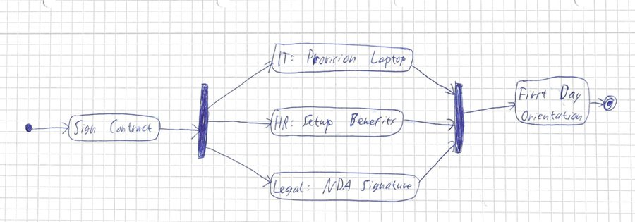
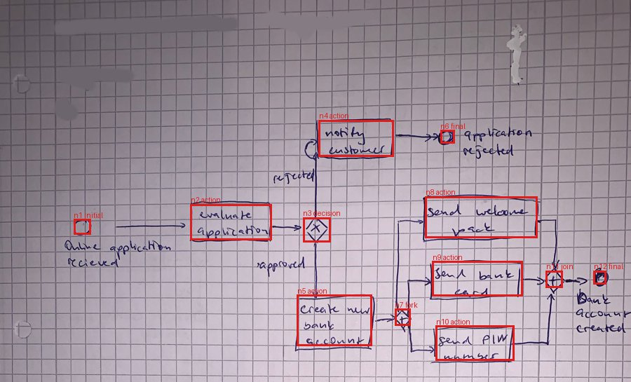

# 🐸 Tadpole

**A tiny model that reads diagrams.** Show Tadpole a flowchart, a UML diagram, a BPMN process or a logic circuit, whether it is hand-drawn on a whiteboard, scanned or exported from a tool. It hands back every box, every label and every arrow as JSON, YAML or XML.

*Why "Tadpole"? A tadpole is a dot with a tail, which is one node and one arrow: the smallest diagram there is. And at 0.73 GB, Tadpole is small enough to run on an ordinary CPU.*

[Training](TRAINING.md) · [Datasets](DATASETS.md) · [Output format (SPEC)](src/diagram_ir/SPEC.md)

Tadpole is a 0.8B-parameter vision-language model, fine-tuned from [Qwen3.5-0.8B](https://huggingface.co/Qwen/Qwen3.5-0.8B).

- **What it writes:** the diagram's elements, their text and kinds, every arrow with its label, and containers such as lanes and packages, with optional positions.
- **In what format:** **DGM**, the compact line format of the [Diagram IR](src/diagram_ir/SPEC.md). Plain code converts DGM losslessly to JSON, YAML or XML.
- **Where it runs:** on a CPU or a GPU through llama.cpp, or with PyTorch.

## Example



*A hand-drawn UML activity diagram from the [CAS2UML](DATASETS.md#cas2uml) test split. The model never saw this image in training.*

This is the model's output, exactly right:

```text
diagram activity dir=TB
node n1 initial
node n2 action "Sign Contract"
node n3 fork
node n4 action "IT: Provision Laptop"
node n5 action "HR: Setup Benefits"
node n6 action "Legal: NDA Signature"
node n7 join
node n8 action "First Day Orientation"
node n9 final
edge n1 n2
edge n2 n3
edge n3 n4
edge n3 n5
edge n3 n6
edge n4 n7
edge n5 n7
edge n6 n7
edge n7 n8
edge n8 n9
```

The same diagram after `python -m diagram_ir convert out.dgm --to json` (excerpt; the real output puts each field on its own line):

```json
{
  "format": "diagram-ir",
  "version": "1.0",
  "type": "activity",
  "direction": "TB",
  "nodes": [
    {"id": "n1", "kind": "initial", "text": ""},
    {"id": "n2", "kind": "action", "text": "Sign Contract"},
    {"id": "n3", "kind": "fork", "text": ""},
    ...
  ],
  "edges": [
    {"id": "e1", "source": "n1", "target": "n2", "kind": "flow", "directed": true},
    ...
  ],
  "groups": []
}
```

`--to yaml` and `--to xml` give the same content as YAML or XML.

## What it reads

| Diagram type | Element kinds it writes (excerpt) | Trained on |
|---|---|---|
| Flowchart | terminal, process, decision, io, document, subroutine, … | rendered Mermaid, Graphviz and PlantUML; tablet ink drawings |
| Activity / BPMN | action, initial, final, decision, merge, fork, join, object, send/receive signal, time event; lanes and pools | hand-drawn BPMN photos, hand-drawn UML, rendered PlantUML, synthetic BPMN |
| Sequence | participant, actor, database, …; sync, async and reply messages; alt, loop and opt fragments | Mermaid, real-world PlantUML |
| Class | class, abstract, interface, enum; attributes and operations; inheritance, composition, aggregation, multiplicities | Mermaid, hand-drawn UML, real-world PlantUML |
| State | state, initial, final, choice, fork, join; composite states | Mermaid, PlantUML |
| ER | entity, relationship, attribute | Mermaid |
| Logic circuit | and, or, not, nand, nor, xor, xnor, buf, inputs and outputs; wires in signal direction | hand-drawn LogicBench scans, synthetic circuits |
| Generic graph | mind maps, architecture, component and use-case diagrams | Mermaid, PlantUML |

The full vocabularies are in the [spec](src/diagram_ir/SPEC.md#2-vocabularies).

- **Boxes (positions).** Ask for "DGM with boxes" and every element also gets a box in 0–1000 coordinates. Boxes are trained only where the training data had real geometry: hand-drawn BPMN photos (hdBPMN), synthetic BPMN and synthetic circuits.



*Tadpole's boxes drawn back onto a photo of a hand-drawn BPMN diagram (hdBPMN test split), from [`demo.ipynb`](demo.ipynb).*

## Results

These are the test-set results on 580 images from 12 sources. "Never trained" marks the three sources whose licenses kept them out of training. For those, the model has never seen the style at all. All numbers use metric v2; see [Evaluation](TRAINING.md#evaluation).

| Source | Style | Edge F1 | Node F1 | Stage 2 edge F1 |
|---|---|---:|---:|---:|
| FlowVQA | rendered flowcharts | 0.988 | 0.998 | 0.979 |
| CAS2UML | hand-drawn UML | 0.958 | 0.992 | 0.902 |
| Image-to-Mermaid v3 | rendered, 6 diagram types | 0.946 | 0.994 | 0.931 |
| rakitha *(never trained)* | rendered flowcharts | 0.921 | 0.955 | 0.870 |
| DiDi | hand-drawn ink flowcharts | 0.917 | 0.968 | 0.920 |
| FlowGen | 4 renderers, scanned copies | 0.899 | 0.981 | 0.881 |
| Flowchart-to-Mermaid | rendered flowcharts | 0.899 | 0.980 | 0.862 |
| The Stack v2 PlantUML | real-world UML | 0.790 | 0.842 | 0.806 |
| UML-in-the-Wild *(never trained)* | real-world UML | 0.746 | 0.711 | 0.719 |
| Handwritten FC/FA *(never trained)* | hand-drawn scans | 0.730 | 0.836 | 0.698 |
| hdBPMN | hand-drawn BPMN photos | 0.694 | 0.932 | 0.625 |
| LogicBench-1K | hand-drawn logic circuits | 0.525 | 0.867 | 0.476 |
| **All 580 images** | | **0.846** | **0.930** | 0.818 |

- **Valid output** (parses without errors) is 99.3%. 36% of answers are exactly right, character for character.
- **Progress over stage 2**, the best purely supervised model: +0.028 edge F1 (95% bootstrap interval +0.017 to +0.039).

**Edges** (arrows with the right endpoints and direction) are the hard part. Text is usually right: 90% of matched elements have exactly the right text. Large hand-drawn diagrams (BPMN with pools, circuits with many gates) are still the weakest; see [Limitations](#limitations).

## Download size and speed

| Files | Size | Runs on | Edge F1 vs PyTorch | Time per diagram |
|---|---:|---|---|---|
| `tadpole-0.8b-Q4_K_M.gguf` + `mmproj-tadpole-0.8b-f16.gguf` | 0.73 GB | CPU or GPU | same within 0.001 | ~7 s on a desktop CPU (i7-13700K, 16 threads) |
| `tadpole-0.8b-Q8_0.gguf` + `mmproj-tadpole-0.8b-f16.gguf` | 1.0 GB | CPU or GPU | same within 0.005 | ~2 s on an RTX 3090 |
| PyTorch checkpoint (safetensors) | 3.4 GB | GPU, or CPU slowly | reference | |

- **Accuracy:** measured on 60 validation images.
- **Times:** they include starting llama.cpp and loading the model for every image; a long-running server answers faster.
- **Where the files are:** the GGUF files are built by [`deploy/export_gguf.py`](src/deploy/export_gguf.py). In this setup they are in `D:/data/diagram_extraction/gguf/tadpole-0.8b/`. They are not yet published on a model hub.

## Quick start

The quickest way to see Tadpole work is [`demo.ipynb`](demo.ipynb). It runs the commands below on example images.

### With llama.cpp (CPU or GPU, no Python needed to run the model)

Get a [llama.cpp release](https://github.com/ggml-org/llama.cpp/releases) (b11577 or newer; Qwen3.5 support is required). Then:

```powershell
llama-mtmd-cli -m tadpole-0.8b-Q4_K_M.gguf --mmproj mmproj-tadpole-0.8b-f16.gguf --jinja `
  --image diagram.png -p "Convert this diagram to DGM." `
  --temp 0 -n 1536 --image-min-tokens 64 --image-max-tokens 1225 > diagram.dgm
```

- **GPU:** with a CUDA, Vulkan or Metal build, add `-ngl 99` to put the whole model on the GPU.
- **Prompt template:** it is stored in the model file. `--jinja` makes llama.cpp use it.
- **Boxes:** to get them too, use `-p "Convert this diagram to DGM with boxes."`.

Then convert:

```powershell
cd src
python -m diagram_ir convert ..\diagram.dgm --to json,yaml,xml -o exports/
```

### With Python (PyTorch)

From `src/`, in an environment set up as in [TRAINING.md](TRAINING.md#setup):

```powershell
python -m deploy.predict diagram.png --to json                     # print JSON
python -m deploy.predict a.png b.jpg --to json,yaml,xml -o out/    # out/a.json, out/a.yaml, ...
python -m deploy.predict photo.jpg --boxes --to json               # with 0-1000 boxes
```

It uses the GPU when there is one.

- **Partial output:** answers are parsed leniently, so a cut-off answer still yields every complete element.
- **Another model:** `--checkpoint` selects a different checkpoint.

### Converting and validating DGM / JSON / YAML / XML

```powershell
cd src
python -m diagram_ir convert diagram_ir/examples/flowchart.dgm --to json
python -m diagram_ir convert some.json --to dgm --canonical
python -m diagram_ir validate exports/flowchart.xml --strict
```

The Python API:

```python
from diagram_ir import load, dump
d = load(text)           # DGM, JSON, YAML or XML; the format is detected
print(dump(d, "yaml"))
```

## Output format

DGM puts one element on each line:

```text
diagram <type> [dir=TB|LR|...]
node <id> <kind> ["text"] [@x1,y1,x2,y2] [key=value ...]
  attr|op|lit "member text"                   # class members, attached to the node above
edge <source> <target> [<kind>] ["label"] [sl=... tl=... style=...]
group <id> <kind> ["label"] [@box] : <member ids>
```

- **One meaning, four formats.** DGM, JSON, YAML and XML all serialize the same data model, so conversions in any direction are lossless. JSON is checked by [`schema.json`](src/diagram_ir/schema.json).
- **Short to generate.** DGM is what the model writes because it is 3–5× shorter than pretty-printed JSON. That makes generation faster and less error-prone.
- **One canonical text per diagram.** Stable ids and nodes in "follow the arrows" order mean the training targets are unambiguous.

The full definition is in [SPEC.md](src/diagram_ir/SPEC.md).

## Repository layout

| Path | What it is |
|---|---|
| [`src/diagram_ir/`](src/diagram_ir) | The data model, DGM parser and writer, JSON/YAML/XML converters, canonical form, validation, metrics; importers for Mermaid, PlantUML and Graphviz; tests |
| [`src/download_dataset/`](src/download_dataset) | Dataset manifests and downloaders (Hugging Face API, git, Zenodo, URLs) |
| [`src/build_dataset/`](src/build_dataset) | One converter per source, the synthetic generators, PlantUML rendering |
| [`src/train_v2/`](src/train_v2) | Supervised training, RL, evaluation, weight merging, model comparison, configs, Windows launcher and dashboard |
| [`src/deploy/`](src/deploy) | GGUF export and check, `predict` CLI, chat template |
| [`docs/images/`](docs/images) | Images used in these docs |
| [`demo.ipynb`](demo.ipynb) | Demo: Tadpole on example images through llama.cpp, with JSON/YAML/XML output and its boxes drawn on a photo |

Code is linted with ruff (config: [`ruff.toml`](ruff.toml)) and the format library has 201 tests:

```powershell
cd src
python -m pytest diagram_ir/tests
```

## How it was built

- **Data.** There are 15 sources with 142,217 image–target pairs. 12 are used for training: rendered, hand-drawn, scanned and photographed diagrams, plus about 26,000 synthetic diagrams generated in this project. The 3 test-only sets have licenses that do not allow training. Every target comes from the source's own structure, never from OCR. → [DATASETS.md](DATASETS.md)
- **Training.**
  1. Three stages of full fine-tuning on one RTX 3090.
  2. Two runs of reinforcement learning (DAPO-style GRPO) whose reward is graph F1.
  3. Weight merges, with the final model chosen on validation data.

  RL exposed a bug in the evaluation metric, which was fixed before the final run. → [TRAINING.md](TRAINING.md)

## Limitations

- **Big circuits.** Circuits with 11 or more gates are mostly wrong: edge F1 0.27, with about 29% of their gates missed. Small circuits do much better: 0.71 for up to 6 gates.
- **Hand-drawn BPMN.** Arrows into collapsed pools are often missing. Long hand-written labels are not always read exactly.
- **Handwriting.** On never-trained handwritten flowcharts, 59% of node texts are exact.
- **Very large diagrams.** Answers are capped at 1,536 tokens. That is enough for most diagrams; larger ones are cut off, and the elements written so far are kept.
- **Boxes.** They are reliable only for the diagram styles that had box annotations in training: BPMN and logic circuits.
- **Out of scope.** The model does not read charts, plots, tables, or electrical schematics with analog components.

## License and acknowledgments

- **Model.** It is built on [Qwen3.5-0.8B](https://huggingface.co/Qwen/Qwen3.5-0.8B) (Apache-2.0). It was trained only on data whose licenses allow it: Apache-2.0, MIT, CC BY 4.0 (attribution required) and permissively licensed code, plus our own synthetic data. See the [license summary](DATASETS.md#license-summary).
- **Code.** Apache-2.0, see [LICENSE](LICENSE).
- **Thanks** to the authors of FlowGen, Image-to-Mermaid, Flowchart-to-Mermaid, FlowVQA, DiDi, hdBPMN, LogicBench-1K, CAS2UML, The Stack v2 PlantUML collection, UML-in-the-Wild and the handwritten diagram datasets (links in [DATASETS.md](DATASETS.md)).
- **Tools:** llama.cpp, PlantUML, Graphviz, Mermaid and schemdraw.
- **Methods:**
  - [DAPO](https://arxiv.org/abs/2503.14476), [Dr. GRPO](https://arxiv.org/abs/2503.20783) — RL;
  - [WiSE-FT](https://arxiv.org/abs/2109.01903) — weight merging.
