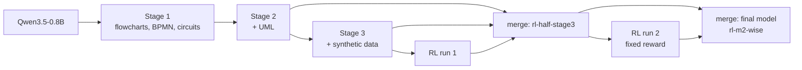

# Training

[README](README.md) · **Training** · [Datasets](DATASETS.md) · [Output format (SPEC)](src/diagram_ir/SPEC.md)

This page explains how Tadpole was trained, why each step was taken, and how to reproduce it: the base model, the three supervised stages, reinforcement learning on graph metrics, weight merging, model selection and the export for download.

## In short

- **Base model:** [Qwen3.5-0.8B](https://huggingface.co/Qwen/Qwen3.5-0.8B) (Apache-2.0, 853M parameters). It pairs a vision encoder with a hybrid Gated DeltaNet / attention language model.
- **Task:** read a diagram image and write its structure as [DGM](src/diagram_ir/SPEC.md#3-dgm--compact-text-format), a compact line format that converts losslessly to JSON, YAML and XML.
- **Recipe:**
  1. three stages of full fine-tuning;
  2. two runs of reinforcement learning (DAPO-style GRPO) whose reward is graph F1;
  3. weight merges;
  4. selection on validation data, then a final check on held-out test data.
- **Released as:** Tadpole 0.8B, which is the final merge `rl-m2-wise`.
- **Result:** on 580 test images from 12 sources, edge F1 is **0.846**, node F1 0.930 and valid output 99.3%. See the [per-source results](README.md#results).
- **Hardware:** one RTX 3090 (24 GB), i7-13700K, 32 GB RAM, Windows 11. Training took about 24 GPU-hours, plus a few hours of evaluation.



## Setup

**Environment.** Python with torch 2.11 (CUDA 12.8) and transformers 5.19, plus:

| Package | Version | Why |
|---|---|---|
| flash-linear-attention (`fla`) | 0.5.2 | Gated DeltaNet kernels for Qwen3.5 |
| triton-windows | 3.8.0 | runs those kernels on Windows |
| bitsandbytes | 0.50.2 | 8-bit AdamW |
| accelerate | 1.15 | model loading |
| safetensors | 0.8 | checkpoints and merges |
| scipy | 1.17 | Hungarian matching in the metric |
| rich, PyYAML, Pillow | – | dashboard, configs, images |

**Base model.**

```powershell
hf download Qwen/Qwen3.5-0.8B --local-dir D:/data/models/Qwen__Qwen3.5-0.8B
```

**Data.** Build `processed_v2/` as described in [DATASETS.md](DATASETS.md#how-the-data-is-built).

**Launching.** Every training run opens in its own Windows Terminal tab with a live dashboard: progress and ETA, loss, learning rate, tokens/s, VRAM, the latest eval scores, the data mix and a log tail. Logs, metrics and checkpoints go to `D:/data/diagram_extraction/runs/<run name>/`.

```powershell
cd src
.\train_v2\launch.ps1 -Smoke                                  # 8-step pipeline check
.\train_v2\launch.ps1 -Config train_v2\config_stage2.yaml     # a training stage
.\train_v2\launch.ps1 -Module train_v2.rl -Config train_v2\config_rl_m2.yaml   # an RL run
```

## What one training example looks like

The image and an instruction go in the user turn. The answer is the DGM target followed by `<|im_end|>`:

```text
<|im_start|>user
<|vision_start|><|image_pad|>…<|vision_end|>Convert this diagram to DGM.<|im_end|>
<|im_start|>assistant
<think>

</think>

diagram flowchart dir=TB
node n1 process "Start"
...
edge n6 n7<|im_end|>
```

- **Loss only on the answer.** Prompt and image tokens are masked.
- **Thinking switched off.** The assistant turn starts with an empty think block, as Qwen3.5 does when thinking is disabled. The exported models keep this template.
- **Two output modes.** Some training sources carry element boxes (hdBPMN, synthetic circuits and synthetic BPMN). For those, half the samples use the prompt "Convert this diagram to DGM with boxes." with the full target. The other half use the plain prompt with boxes stripped. Every other source always uses the plain prompt.
- **Image size.** Images are scaled to between 65,536 and 1,254,400 pixels (about 256² to 1120²). At 16-pixel patches merged 2×2, that is 64 to 1,225 visual tokens per image.

## Fitting a full fine-tune on one 24 GB GPU (on Windows)

All weights are trained, including the vision tower, which uses half the learning rate. These choices made that fit and run at about 3,000 tokens/s and 16.8 GB VRAM at batch size 4:

- **fp32 master weights with bf16 autocast**, and **8-bit AdamW** (bitsandbytes). The 8-bit optimizer saves about 5 GB compared with fp32 optimizer states.
- **Gradient checkpointing.**
- **Chunked, checkpointed loss.** The 248k-token vocabulary makes full logits enormous. The loss runs the base model, keeps only answer positions, and computes `lm_head` plus cross-entropy in checkpointed chunks of 1,024 tokens. Peak memory dropped from over 24 GB to about 10 GB.
- **A hard VRAM cap** (`torch.cuda.set_per_process_memory_fraction(0.94)`). On Windows the driver silently spills overflowing VRAM into system RAM, which runs 10–100× slower instead of failing. With the cap, an oversized batch raises out-of-memory and is skipped.
- **Padding to a multiple of 128 tokens.** The Triton kernels compile once per sequence shape, so this keeps the shapes to a few dozen.
- **Length-grouped batches**, so little compute goes to padding.
- **6 DataLoader workers** for image decoding and resizing.
- **Checkpoints every 250 steps (about 28 minutes) with automatic resume.** A power cut during stage 1 cost minutes, not hours. Each run saves its exact settings in `config.used.json`. Resuming with those same data settings keeps the epoch's data order unchanged (that is what `config_stage1_resume.yaml` is).

Optimizer settings for all supervised stages:

- batch 4 × gradient accumulation 4 = 16, one epoch;
- weight decay 0.01, gradient clipping 1.0;
- linear warmup (2–3% of steps), then cosine decay to 10% of the peak learning rate.

## Training stages

| Stage | Starts from | Data (details in [DATASETS.md](DATASETS.md#how-each-training-stage-used-the-data)) | Samples | Steps | Peak LR | Time |
|---|---|---|---:|---:|---:|---:|
| 1 | Qwen3.5-0.8B | 7 sources: flowcharts, hand-drawn BPMN, circuits | 41,154 | 2,573 | 2e-5 | 5.3 h |
| 2 | stage 1 | + hand-drawn and real-world UML (9 sources) | 54,633 | 3,415 | 1e-5 | 5.6 h |
| 3 | stage 2 best | + synthetic circuits, BPMN and PlantUML, with replay of all real sources | 29,014 | 1,814 | 8e-6 | 3.1 h |
| RL 1 | stage 3 best | RL with reward metric v1 | 4 images × 6 answers per step | 300 | 1e-6 | 5.3 h |
| RL 2 | merge `rl-half-stage3` | RL with the fixed reward (metric v2) | 4 images × 6 answers per step | 300 | 1e-6 | 5.0 h |

**Stage 1** learned the format on flowcharts, hand-drawn BPMN and circuits. Stage 1 ran with the 7 sources listed in [`config_stage1_resume.yaml`](src/train_v2/config_stage1_resume.yaml); [`config.yaml`](src/train_v2/config.yaml) has since gained the UML sources.

**Stage 2** continued at half the learning rate with the full real mix, adding CAS2UML and The Stack v2 PlantUML.

**Stage 3** targeted the weakest areas (circuits, BPMN, varied UML styles) with about 14,000 synthetic diagrams, replaying every real source so nothing was forgotten.

- **What improved:** validation on the synthetic sets rose a lot. Edge F1 went from 0.20 to 0.69 on synthetic circuits, from 0.77 to 0.91 on synthetic BPMN and from 0.70 to 0.90 on synthetic PlantUML.
- **What got worse:** the real sources. Averaged over the 9 real validation sources, edge F1 fell from 0.865 to 0.829. The synthetic look did not carry over to real photos and scans (a "sim-to-real" gap).
- **How that was fixed:** later steps recovered it with RL and weight merging; see below.

### Results along the way

Validation scores come from the same 300 images, 25 from each of 12 sources (seed 11), all scored with the final metric (v2). "Mean per source" averages edge F1 over the 12 sources, so each source counts equally. It is the number used to pick the final model.

| Model | Mean per source | Edge F1 | Node F1 | Test edge F1 (580 images) |
|---|---:|---:|---:|---:|
| Stage 1 | 0.641 | 0.683 | 0.825 | – |
| Stage 2 | 0.788 | 0.815 | 0.910 | 0.818 |
| Stage 3 | 0.829 | 0.850 | 0.930 | – |
| RL 1 | 0.845 | 0.869 | 0.977 | 0.822 |
| merge `rl-on-stage2` | 0.800 | 0.828 | 0.918 | – |
| merge `rl-half-stage3` | 0.846 | 0.874 | 0.977 | 0.836 |
| RL 2, best checkpoint (step 200) | 0.852 | 0.880 | 0.981 | – |
| RL 2, final (step 300) | 0.855 | 0.881 | 0.980 | – |
| **final model `rl-m2-wise`** | **0.855** | **0.881** | **0.981** | **0.846** |

On the test set, the final model beats stage 2 by +0.028 edge F1 (95% bootstrap interval +0.017 to +0.039). It beats the previous best, `rl-half-stage3`, by +0.009 (+0.002 to +0.018). Both comparisons use the same images.

## Evaluation

[`diagram_ir/metrics.py`](src/diagram_ir/metrics.py) compares a predicted diagram with the gold one through a node matching:

- **Node matching.** Nodes are paired by a maximum-weight (Hungarian) assignment on text similarity and kind. Text-free nodes, such as logic gates, fall back to kind, number of connections and position.
- **Refinement for identical-looking nodes.** Nodes with the same kind and text are then allowed to trade partners whenever that makes more edges agree. Degree and position alone often pair identical gates wrongly.
- **Groups.** Containers (pools, lanes, composite states, packages) are matched by label, or by shared members when unlabeled. This lets edges that end at a container be scored.

| Metric | Meaning |
|---|---|
| node F1 | matched nodes |
| edge F1 | edges whose mapped endpoints match a gold edge (direction-aware; either direction for undirected kinds) |
| edge+label F1 | the same, and the edge label must match too |
| kind accuracy | matched nodes with the right shape or kind |
| text exact | matched nodes whose text is identical after whitespace and case normalization |
| valid | the output parsed without syntax errors |
| exact | the canonical output equals the gold target |

Counts are summed over a set (micro-average) before computing F1. The metrics do not depend on order, so a correct graph written in another order scores 1.0.

```powershell
cd src
python -m train_v2.evaluate <checkpoint> --split test --per-source 50          # one checkpoint
.\train_v2\launch.ps1 -Module train_v2.compare -Config train_v2\config_compare.yaml   # many, then the winner on test
```

### The metric bug that RL found

After the first RL run, a simple sanity check failed: **a diagram scored against itself must get 1.0 on every metric.** 200 test diagrams did not; in hdBPMN it was 71 of 128. There were two causes:

1. **Edges ending at a group could never match.** In metric v1 only nodes were mapped, so an arrow into a collapsed BPMN pool or a composite state always counted as wrong.
2. **Identical-looking text-free nodes were paired by degree and position, not by wiring.** This understated circuits: per-image edge F1 on LogicBench went from 0.56 to 0.64 with edge-aware pairing.

Metric v2 fixes both and comes with regression tests:

- a fuzz test on 3,000 random circuits: never worse than v1, better in 15% of cases, and equal to the brute-force best pairing in 99%;
- the self-score check, now at 0 failures.

Every result on these pages is scored with v2. Stored predictions were re-scored, not regenerated; [`compare.py`](src/train_v2/compare.py) does this automatically when the metric version changes.

## Reinforcement learning

Supervised training teaches the format. RL then optimizes what we care about, graph accuracy, directly on the model's own outputs. [`train_v2/rl.py`](src/train_v2/rl.py) implements DAPO-style GRPO with the Dr. GRPO fixes:

- **Groups.** For each training image the model samples K = 6 answers at temperature 1.0. Each step uses 4 images.
- **Reward:** 0.5 · edge F1 + 0.2 · node F1 + 0.2 · edge+label F1 + 0.1 · valid. 0.2 is subtracted if the answer hits its length cap, which is 1.6 × the gold length + 64 tokens (DAPO overlong shaping). The metrics do not depend on order, so a correct graph in another order is not penalized.
- **Advantage:** reward minus the group mean, without dividing by the group's standard deviation (Dr. GRPO: no difficulty bias).
- **Dynamic sampling.** Groups whose answers all score the same carry no signal. They are dropped and replaced with fresh images, up to 3 extra rollout rounds.
- **Loss:** the clipped policy-gradient objective, averaged over all tokens of the step (token-level). Clip range 0.2 / 0.28 ("clip-higher"; it only matters with more than one update per rollout). No KL penalty. Learning rate 1e-6 with 10 warmup steps.
- **Prompt pool.** Before training, a greedy pass scores 120 candidate images per source. The pool keeps the ones the model does not yet solve exactly, plus 10% of the solved ones, so generation time goes where there is something to learn.
- **Memory.** Log-probabilities are computed in checkpointed chunks, like the supervised loss.

**RL run 1** (from stage 3) raised the training reward from 0.77 to 0.85. Edge F1 on its own small validation check (8 images per source, metric v1) went from 0.855 to 0.887. It also nearly eliminated runaway loops: on the test set, answers stuck repeating nodes went from 9 of 580 (stage 2) to 1. **However, it had learned to exploit the metric bug.** Arrows into pools could never earn credit and only lowered precision, so it stopped drawing them:

| hdBPMN validation (32 gold arrows to pools) | Stage 2 | Stage 3 | RL 1 |
|---|---:|---:|---:|
| arrows to pools predicted | 31 | 29 | 12 |

On synthetic BPMN validation (8 gold arrows to pools) it predicted none. With the metric fixed, RL 1's real gain over stage 2 on the test set shrank to +0.004, which is not significant.

**RL run 2** started from the best merge with the fixed reward. Its settings are in [`config_rl_m2.yaml`](src/train_v2/config_rl_m2.yaml):

- prompt weights favor the remaining weak spots;
- evals were larger (12 images per source, every 50 steps), because 8 per source was too noisy to pick a "best" checkpoint.

On its own validation check (12 images per source), edge F1 went from 0.844 to 0.865 at its best checkpoint. The biggest gains were synthetic circuits (0.60 → 0.71) and hdBPMN (0.68 → 0.72). Arrows to pools started to come back.

**Lesson:** before RL, check that the reward gives a perfect answer full marks. After RL, look at *what* changed, not just the score.

## Weight merging

All checkpoints descend from stage 2, so their weights can be combined linearly. [`train_v2/merge.py`](src/train_v2/merge.py) writes any weighted sum whose weights add up to 1. That covers two techniques:

- **WiSE-FT** (interpolation, Wortsman et al. 2022);
- **task arithmetic** (moving one run's update onto another starting point).

| Merge | Recipe | Outcome |
|---|---|---|
| `rl-on-stage2` | stage 2 + (RL 1 − stage 3) | the RL update without the synthetic round: barely better than stage 2, because RL's gains depend on the stage-3 weights |
| `rl-half-stage3` | 0.5 · stage 2 + RL 1 − 0.5 · stage 3 | RL 1 plus half of the stage-3 update: beat stage 2 on 11 of 12 test sources, and was the starting point for RL 2 |
| `rl-m2-wise` (final) | 0.5 · `rl-half-stage3` + 0.5 · RL 2 final | halfway between RL 2's start and end: best overall |

Expanded, the final model is 0.25 · stage 2 − 0.25 · stage 3 + 0.5 · RL 1 + 0.5 · RL 2.

```powershell
cd src
python -m train_v2.merge --out D:/data/diagram_extraction/runs/merges/rl-half-stage3 `
  -m D:/data/diagram_extraction/runs/v2-qwen35-0.8b-stage2/best 0.5 `
  -m D:/data/diagram_extraction/runs/v2-rl-dapo/final 1 `
  -m D:/data/diagram_extraction/runs/v2-qwen35-0.8b-stage3/best -0.5
```

## Model selection

[`train_v2/compare.py`](src/train_v2/compare.py) reads [`config_compare.yaml`](src/train_v2/config_compare.yaml) and does the following:

1. Builds any missing merges.
2. Scores every candidate on the same 300 validation images.
3. Ranks them by mean per-source edge F1.
4. Scores the winner and the stage-2 baseline on the same 580 test images.

These test images are 50 per source (30 for CAS2UML) from 12 sources. Three of those sources, the handwritten sets, rakitha and UML-in-the-Wild, were never trained on.

- **Resumable.** Each finished evaluation is saved right away, so an interrupted comparison picks up where it stopped.
- **Re-scoring.** When only the metric changed, stored predictions are re-scored without generating again.
- **Output.** Results go to `runs/compare-post-rl/summary.json`.

Candidates are ranked on validation data only. The test set is scored only for each round's winner and the stage-2 baseline. Differences are judged with a paired bootstrap over images, because 50 images per source cannot separate models that differ by 0.01.

## Export for download (GGUF)

llama.cpp supports Qwen3.5: a text model with architecture `qwen35`, plus a Qwen3-VL-style vision projector. [`deploy/export_gguf.py`](src/deploy/export_gguf.py) does three things:

1. converts the checkpoint;
2. writes the DGM chat template, with its empty think block, into the files, so `llama-mtmd-cli --jinja` formats prompts exactly as in training;
3. quantizes.

```powershell
cd src
python -m deploy.export_gguf D:/data/diagram_extraction/runs/merges/rl-m2-wise `
  --out D:/data/diagram_extraction/gguf/tadpole-0.8b `
  --llama-src D:/data/tools/llama.cpp-b11577 --llama-bin D:/data/tools/llama-b11577-cpu
python -m deploy.eval_gguf --llama-bin D:/data/tools/llama-b11577-cuda --gpu-layers 99 `
  --model D:/data/diagram_extraction/gguf/tadpole-0.8b/tadpole-0.8b-Q8_0.gguf `
  --mmproj D:/data/diagram_extraction/gguf/tadpole-0.8b/mmproj-tadpole-0.8b-f16.gguf
```

[`deploy/eval_gguf.py`](src/deploy/eval_gguf.py) runs the exported model on 60 validation images (5 per source) and compares it with the PyTorch model on the same images. The full set of measurements was made on the `rl-half-stage3` export, where PyTorch scores 0.886 edge F1:

| Model files | Size | Device | Edge F1 | Seconds per image, including model load |
|---|---:|---|---:|---:|
| Q8_0 + vision f16 | 1.0 GB | RTX 3090 | 0.886 | 2.3 (about 2.2 of it is loading) |
| Q8_0 + vision f16 | 1.0 GB | i7-13700K, 16 threads | 0.881 | 10.0 (CPU was shared with another job) |
| Q4_K_M + vision f16 | 0.73 GB | i7-13700K, 16 threads | 0.885 | 7.2 |

On the final model, the Q8_0 GPU check gives 0.879 against PyTorch's 0.884. Quantization costs essentially nothing in accuracy. The bf16 GGUF (1.5 GB) is kept as the reference.

## Reproducing from scratch

```powershell
cd src
# 0. data and base model: see DATASETS.md and "Setup" above
python -m build_dataset --all
# 1-3. supervised stages
.\train_v2\launch.ps1 -Config train_v2\config_stage1_resume.yaml   # stage 1 exactly as run
.\train_v2\launch.ps1 -Config train_v2\config_stage2.yaml
.\train_v2\launch.ps1 -Config train_v2\config_stage3.yaml
# 4. RL run 1, then the merge it is combined with
.\train_v2\launch.ps1 -Module train_v2.rl -Config train_v2\config_rl.yaml
python -m train_v2.merge --out D:/data/diagram_extraction/runs/merges/rl-half-stage3 -m <stage2/best> 0.5 -m <rl/final> 1 -m <stage3/best> -0.5
# 5. RL run 2 (fixed reward)
.\train_v2\launch.ps1 -Module train_v2.rl -Config train_v2\config_rl_m2.yaml
# 6. build the final merge, rank all candidates, test the winner
.\train_v2\launch.ps1 -Module train_v2.compare -Config train_v2\config_compare.yaml
# 7. export
python -m deploy.export_gguf D:/data/diagram_extraction/runs/merges/rl-m2-wise --out D:/data/diagram_extraction/gguf/tadpole-0.8b --llama-src <llama.cpp source> --llama-bin <llama.cpp binaries>
```

## Tadpole Nano 258M

The goal was a smaller model that runs faster on a CPU. The config is [`config_small.yaml`](src/train_v2/config_small.yaml).

**Choosing a base.** The candidates had to be small, Apache-2.0 and convertible by llama.cpp.

- LFM2.5-VL-450M was ruled out because its license restricts larger companies.
- FastVLM was ruled out because it is licensed for research only.
- The two that qualified, Granite-Docling-258M and SmolVLM-256M-Instruct, share an architecture: a SigLIP vision encoder that reads 512-px tiles, 64 tokens per tile, and a 576-wide, 30-layer language model.
- Each trained 800 steps on the same data, then paused (`stop_after_steps`). Granite-Docling won on every overall measure at the same speed:

| At step 800 (96 val images) | Granite-Docling | SmolVLM |
|---|---:|---:|
| Validation loss | **0.374** | 0.402 |
| Node F1 | **0.582** | 0.469 |
| Edge F1 | **0.193** | 0.150 |
| Valid output | **91%** | 81% |

**Image size was measured before training.** A tiled model at its native 2048 px reads up to 17 tiles, about 17,000 patches through the vision encoder. On a CPU (llama.cpp, 16 threads, 300 output tokens):

| | Reading the image | Writing 300 tokens | Total, incl. loading |
|---|---:|---:|---:|
| Tadpole 0.8B | 0.4–0.7 s | 4.3–4.5 s | 7.1–7.6 s |
| Nano at 2048 px | 2.7–3.9 s | 1.5–1.6 s | 5.3–6.9 s |
| **Nano at 1536 px** | 2.1 s | ~1.5 s (same model) | **4.4–4.5 s** |
| Nano at 1024 px | 0.9–1.5 s | ~1.5 s (same model) | 2.9–3.6 s |

At 1536 px Nano sees about the same detail as Tadpole 0.8B and is about 1.7× faster in this test. The trainer writes the size (`image_longest_edge`) into the saved processor config, and the llama.cpp converter reads it from there, so training and inference match.

**Training.** One run on the final data mix: every real training source plus the synthetic sets, 68,600 samples per epoch, 2 epochs (8,580 steps), learning rate 4e-5, about 9 hours. There was no RL.

**Result.** On the 580 test images, Nano gets node F1 0.834 but edge F1 only **0.444**, against 0.846 for Tadpole 0.8B. It trails on every source.

- **Why:** it reads text well but wires arrows badly. The likely reasons are its language model, about 4× smaller, and reading the image as separate tiles, so arrows that cross tile edges are harder to follow. Validation edge F1 levelled off around 0.49 over the last quarter of training.
- **GGUF:** Q8_0 matches PyTorch (0.418 vs 0.428 on 60 images) at 4.8 s per diagram on the CPU. Q4_K_M breaks this small model (0.267), so it is not published.

It is published as a smaller, faster option with these numbers on its card. [`config_compare_small.yaml`](src/train_v2/config_compare_small.yaml) reproduces the comparison.

## Lessons learned

1. **Windows spills VRAM silently.** Cap the per-process memory fraction, so an oversized batch fails fast instead of running 10–100× slower.
2. **Check the stop token.** The base model's generation config stopped on `<|endoftext|>`, but chat answers end with `<|im_end|>`. Generation ran on into a new turn, and "valid output" looked like 45% when it was really 97%. Training and evaluation now stop on both.
3. **Large vocabularies need a chunked loss.** Never materialize full logits for long sequences.
4. **Small tooling traps.** `wt.exe` splits command lines on `;`, so pass it a `.ps1` file. Triton recompiles per shape, so pad lengths.
5. **Transparent PNGs turn black** with a plain `convert("RGB")`. Composite them onto white.
6. **Synthetic data does not automatically transfer.** It taught synthetic styles well but hurt the real sources: real validation edge F1 fell from 0.865 to 0.829. Measure the real sets before trusting synthetic gains. RL and weight merging recovered the loss.
7. **RL optimizes the metric you give it, bugs included.** A self-score test (a gold diagram against itself must get 1.0) would have caught the bug before training.
8. **Small evaluations are noisy.** 8 images per source could not separate checkpoints. Use more images and paired bootstrap intervals.
9. **Measure deployment speed before training a "faster" model.** Tiled vision encoders can cost more than a bigger model's whole answer. Nano at its native resolution would have been barely faster than Tadpole 0.8B.

## Where it is still weak, and next steps

- **Large logic circuits.** Test edge F1 is 0.53 on LogicBench: 0.71 for circuits with up to 6 gates, but 0.27 for 11 or more, where about 29% of gates go missing. Upscaling the 512×512 images at test time did not help. The next step is synthetic circuits drawn like LogicBench's large ones, then a short training round.
- **Arrows to pools in hand-drawn BPMN.** The final model writes 59 of the 103 in the test set (stage 2 wrote 110). The next round should replay hdBPMN and synthetic BPMN.
- **Reading handwriting in flowcharts.** On the never-trained handwritten flowcharts, only 59% of node texts are exact.
- **A smaller model for CPU.** Tadpole Nano 258M (above) is 1.5× faster but much weaker on arrows. Next options: RL on Nano, a ~500M base, or speeding up Tadpole 0.8B itself, for example by keeping it loaded as a server.
